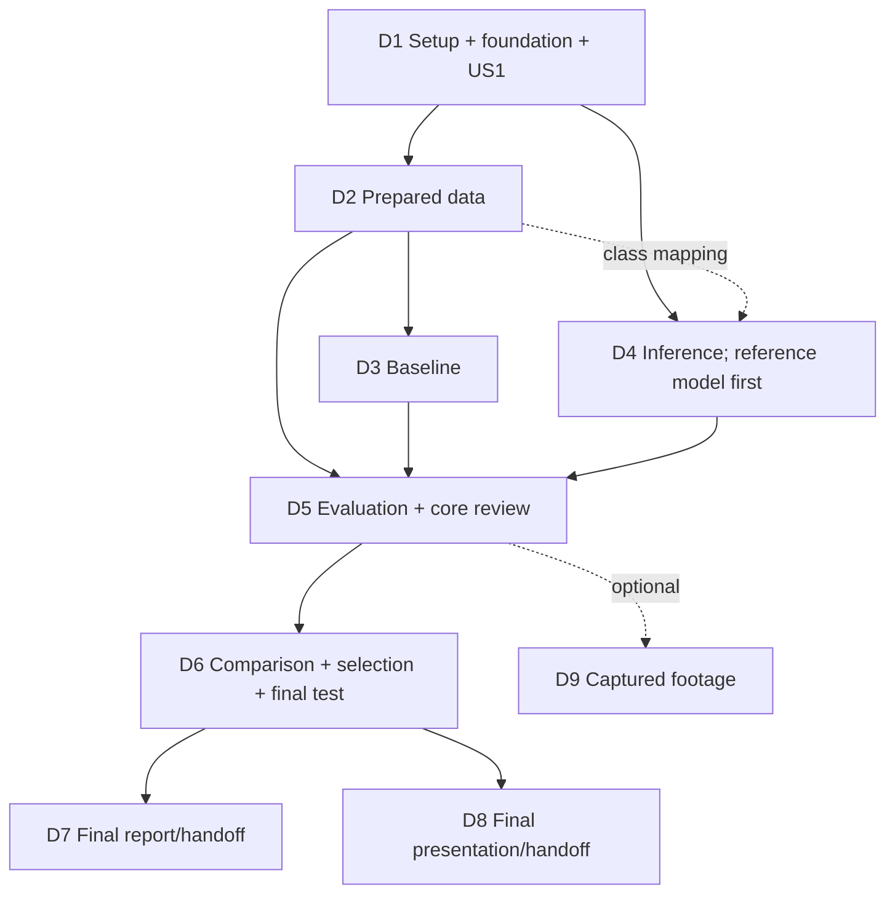

# Tasks: Driving Scene Object Detection

**Input**: [spec.md](spec.md), [plan.md](plan.md), [research.md](research.md), [data-model.md](data-model.md), [contracts](contracts/cli.md), and [quickstart.md](quickstart.md).

**Scope**: Nine cohesive PR deliverables, six command handlers, direct established-library wrappers. Preserve all 39 functional requirements. No backend framework, generic schema engine, experiment orchestrator, public fixture generator, custom resume/exposure system, or automated test suite.

**Tests**: None (constitution v2.0.0 Principle VII; revised 2026-11-10). Do not add test modules, fixtures, pytest or diagnostic-only scripts. Verify each task by running the real commands and manually reviewing their outputs: preparation's built-in integrity checks, one short labeled smoke training run, real inference outputs and hand-counted metric matches. T008 and T019 were removed for this reason; their IDs are kept so references stay stable. Do not repeat full training without a material reason.

**Organization**: One contiguous phase per user story. Dependency order places required US6 optimization before final US7/US8 claims even though those course handoffs have higher importance; their preparation can start earlier. Phase numbering is not a prohibition on the explicit parallel opportunities below.

## Format: `[ID] [P?] [Story] Description`

- Every unchecked item is actionable work, not a claim of implementation.
- `[P]` means the task can overlap a listed independent task once its stated inputs exist, not that prerequisites can be ignored.
- `[USn]` identifies the sole owning deliverable. Setup/foundation/final audit have no story label.
- Paths are repository-relative. Large data/checkpoints/media go under ignored `data/`, `external/`, `artifacts/`; tracked `results/` holds small summaries and team-accessible retrieval pointers.
- Add usage updates and a concise `docs/ai-use-log.md` entry for each completed AI-assisted task as part of that task, not as a later cleanup feature. Record actual checks and limitations. A task requiring real measurements is not complete with smoke runs or small samples alone.
- Student-action tasks cannot be completed by generated prose or assumed uploads. Keep them pending until actual evidence exists; no external messages, permission changes or submissions are authorized merely by generating this list.

## Phase 1: Setup — included in D1 PR

**Purpose**: Create only the package/CLI and ignore rules required by the pipeline. No independent infrastructure PR is needed.

- [X] T001 [P] Initialize Python 3.10–3.14 package metadata in `pyproject.toml` and `src/driving_detection/__init__.py`, declaring the planned dependencies and package entry point without adding lint/CI frameworks or extra services.
- [X] T002 [P] Add `.gitignore` rules for `.venv/`, `data/`, `external/`, `artifacts/`, credentials and local caches while preserving tracked configs, compact results and existing `.specify/feature.json` ignore behavior.

**Checkpoint**: Package files and safe local asset/output locations exist. T001 and T002 are independent.

## Phase 2: Foundational — included in D1 PR

**Purpose**: The small shared file helpers and command dispatch needed by all stories. Depends on T001–T002 and blocks story implementation.

- [X] T003 Implement ordinary argparse dispatch for the six documented handlers in `src/driving_detection/__main__.py` and only shared config/file/hash/run-directory helpers actually needed in `src/driving_detection/records.py`; support paths with spaces, point-of-use validation, saved resolved settings and byte SHA-256, lazy heavy imports, requested-device failure and clear nonzero errors. Enforce "Do not overwrite existing run directories" and "Use status=completed/failed/interrupted in run.json; a retry gets a new ID"; add no registry, schema framework or lifecycle engine.

**Checkpoint**: `python -m driving_detection --help` works without downloading a model or needing CUDA. Unimplemented handlers fail clearly. Config/argument shapes match [CLI](contracts/cli.md) and [file contracts](contracts/records.md); later stories own handler implementations.

## Phase 3: User Story 1 — Reproduce project setup (Priority: P1; D1)

**Goal / coverage**: Fresh/repeat setup and documented acquisition. FR-001–FR-004; SC-001 and shared SC-009.

**Dependencies**: T003. T004 and T005 are independent; T006 consumes their configuration; T007 verifies the resulting setup.

**Independent test**: A teammate follows the instructions from a fresh environment and repeats setup; valid assets/results are reused, missing access/corrupt downloads produce actionable failure, imports and official checkpoint loading work. No training probe is duplicated here.

- [X] T004 [P] [US1] Resolve and record the researched dependency targets in `requirements/cpu-lock.txt` and `requirements/cuda-lock.txt` for the actual Windows CPU and Linux GPU environments used; resolve the bounded dependencies in `pyproject.toml` for the actual interpreter (allowed Python 3.10–3.14, including Colab 3.13 and local 3.14.7 / 3.10), choose a matched torch/torchvision pair and compatible device wheels, preserving complete installed versions/wheel provenance and documenting compatibility changes rather than claiming untested support.
- [X] T005 [P] [US1] Define BDD100K 100K images, Detection 2020 labels, YOLOv5 v7.0 commit `915bbf294bb74c859f0b41f1c23bc395014ea679`, and official yolov5s.pt sources/checksums/expected members in `configs/assets.yaml`; cite source/license/terms and unavoidable access prerequisites in `docs/references.md`, never inventing an unpublished publisher checksum or storing credentials.
- [X] T006 [US1] Implement `assets sync` and `check` in `src/driving_detection/assets.py`: accept authorized local archives or configured public downloads, verify checksum/member/source identities, reject unsafe extraction paths, stage then promote verified assets, reuse valid inputs, preserve results, and report manual access/recovery. Handle modern torch checkpoint loading and Pillow text APIs at pinned YOLO integration points as needed; check imports/checkpoint/device readiness while reporting absent data separately for model-only readiness; write the compact inventory to `artifacts/assets.json`.
- [X] T007 [US1] Follow fresh/repeat CPU setup and requested-GPU readiness with a teammate; check interrupted/hash-failed small acquisition cases operationally and record verified environments, reused assets, failures and retrieval instructions in `results/experiments.md`; document exact setup/input/output commands in `docs/usage.md` and link them from `README.md`.

**Execution status (2026-11-05)**: T001–T007 are complete. CPU and Colab CUDA locks preserve the recorded platform-specific environments and wheel provenance. Supplied Colab evidence verifies first/repeated GPU readiness on Python 3.13.16/Tesla T4/CUDA 12.8 with unchanged source/checkpoint identities; Marc Benamou confirmed review completion. See [setup evidence](../../results/experiments.md) and its compact [Colab record](../../results/us1-colab-evidence.json). No training or dataset readiness is claimed; reinstalling the finalized CUDA lock in another runtime has not been separately checked.

**Merge review (2026-11-10)**: SC-001 asks for a teammate other than the setup author; Marc Benamou accepted their own Colab run as that check, recorded as a deviation in [setup evidence](../../results/experiments.md). Test-only packages (`pytest`, `pluggy`, `iniconfig`) were removed from both locks and `pyproject.toml` under Principle VII.

**PR boundary**: Merge T001–T007 together as D1, including relevant AI-use entries. Environment evidence states what was actually checked; pipeline training compatibility is verified later. No bulk data/weights are committed.

## Phase 4: User Story 2 — Prepare trustworthy data (Priority: P1; D2)

**Goal / coverage**: Validated, frozen, sequence-disjoint three-class data. FR-005–FR-010; SC-002.

**Dependencies**: T009–T012 are sequential and use accepted D1 assets/config. Keep all changes in the D2 PR.

**Independent test**: Prepare the real profile, review its built-in integrity counts/reasons, class coverage, zero overlap and a few label overlays, then repeat preparation for identical manifests. No training needed.

- T008 Removed 2026-11-10 (Principle VII: no automated tests). The label, box, negative, provenance and coverage rules it covered are enforced by preparation itself (T009–T010) and reviewed in T012.
- [X] T009 [US2] Implement BDD image/annotation ingestion, class/alias mapping, ignored-sample exclusions and canonical geometry in `src/driving_detection/data.py`, with the source/profile choices in `configs/data/bdd-subset.yaml`; honor "Canonical classes are car=0, pedestrian=1, traffic_light=2" and "Annotations=[] is a valid negative; missing annotations are not assumed negative." Apply "Convert inclusive source endpoints once to half-open continuous boxes with positive area inside decoded image dimensions" and "Unknown classes/provenance and invalid boxes quarantine samples"; retain source values/clipping notes and the ignore policy in `contracts/pipeline.md`.
- [X] T010 [US2] Add eligible-sequence selection and integrated integrity checks to `src/driving_detection/data.py`: use explicit videoName or the documented recording-session filename prefix (one image per sequence), quarantine duplicate identities/content, rank by SHA256 of `cs4337-v1:4337:` plus sequence ID, select 5,000 official-train and first/next 1,000 official-val sequences for val/test; "Check zero sequence/content overlap, all three classes in each evaluated partition, and sufficient eligible samples." Retain negatives and fail instead of silently changing the split.
- [X] T011 [US2] Export `data/prepared/bdd-subset-v2/profile.json`, `manifest.train.jsonl`, `manifest.val.jsonl`, `manifest.test.jsonl`, YOLO train/val labels and COCO ground truth from the same canonical boxes in `src/driving_detection/data.py`; preserve class/count/exclusion/transformation provenance, stable sorted membership and byte hashes, valid negative labels, category IDs 1–3 for COCO and train/val-only training YAML. "Freeze the profile/manifests before training"; changed inputs need a new profile rather than overwriting reported membership.
- [X] T012 [US2] Run actual data preparation, review its integrity counts and quarantine reasons (unknown/ignored/invalid labels, negatives, provenance, overlap, coverage), inspect representative label overlays/YOLO–COCO geometry including a small or edge box, and repeat preparation for stable reuse; record requested/actual class/sequence/sample/negative/exclusion counts and zero-overlap checks in `results/experiments.md`, update `docs/usage.md`, and preserve the real frozen profile/artifact retrieval pointers before accepting D2.

**Execution status (2026-11-10)**: T009–T012 are complete. `bdd-subset-v2` was prepared from the pinned mirror archives with the 2018 per-image labels (Detection 2020 labels are unavailable; see research R2), passed all integrity checks and reused on repeat. The first run, v1, was replaced before use because 121 recording-session prefixes crossed val/test; v2 uses one image per session (research R4 update). Counts, overlay/geometry review and retrieval are in [experiments](../../results/experiments.md).

**PR boundary**: D2 is complete only with actual preparation/integrity evidence, or explicitly remains incomplete if data access fails. No alternate dataset or annotation release is silently introduced.

## Phase 5: User Story 3 — Train a reproducible baseline (Priority: P1; D3)

**Goal / coverage**: One loadable trained detector and honest experiment record. FR-011–FR-014; SC-003.

**Dependencies**: Configuration/wrapper development uses T003 and the agreed D2 file shapes; the smoke run in T014 and the real run T015 require T012.

**Independent test**: Run one short smoke training with the normal `train` command, load its output and audit the saved settings/history. Measured baseline acceptance requires the completed declared GPU run, not a synthetic score.

- [X] T013 [P] [US3] Define the full baseline settings in `configs/train/baseline.yaml`: YOLOv5s initial weights, size 640, batch 8, 20 epochs, workers 0, seed 4337, <=8 GPU-hours, explicit SGD/schedule/augmentation values from `contracts/pipeline.md`, no autoanchor or early stopping, and validation-fitness checkpoint choice with earliest-epoch ties; allow recorded pre-run batch 4/2 fallback. Add `configs/train/smoke.yaml` differing only by one epoch, size 320 and batch 2.
- [X] T014 [US3] Implement direct pinned-upstream training invocation in `src/driving_detection/train.py`, disabling auto-install/trackers, using train/val only and seeded explicit settings; save all FR-012 fields, effective optimizer/batch behavior, source/config/environment/manifest/checkpoint identities, logs/history and chosen checkpoint in the ordinary run directory. Preserve "Use status=completed/failed/interrupted in run.json; a retry gets a new ID" and budget interruption without a custom resume system; verify output head names/count and loadability. Verify by running the smoke config into `artifacts/runs/smoke-01/` (labeled smoke, never reported accuracy) and record the result in `results/experiments.md`.
- [X] T015 [US3] Train the declared GPU baseline into `artifacts/runs/baseline-01/`, verify `weights/best.pt` loads and uses the three canonical classes, and audit every FR-012 field with a teammate; record completion/failure, hardware/budget/nondeterminism, checkpoint retrieval and exact repeat/load commands in `results/experiments.md` and `docs/usage.md`. Keep smoke/reference runs distinct and do not inspect test performance or rerun full training merely for unrelated checks.

**Execution status (2026-11-11)**: `baseline-01` completed on a Colab T4 (20 epochs, 0.82 h, chosen epoch 16) and passed Claude Code's checks; see [experiments](../../results/experiments.md). Marc Benamou reviewed the FR-012 audit and accepted it on 2026-11-11.

**PR boundary**: D3 includes the wrapper/config and completed baseline evidence; interrupted runs stay visible and do not satisfy baseline completion. The smoke run is training-compatibility evidence only.

## Phase 6: User Story 4 — Inspect detections on new scenes (Priority: P1; D4)

**Goal / coverage**: Image/video predictions and reviewable annotations with clear failure/empty behavior. FR-015–FR-017; SC-004.

**Dependencies**: D1 and agreed canonical D2 mapping. Reference COCO development can overlap D3; actual baseline integration is required at the D5 core review.

**Independent test**: Run a compatible checkpoint on a small image set and short video, inspect predictions/saved media, exercise a valid empty result and unreadable/incompatible inputs.

- [X] T016 [P] [US4] Implement direct YOLO loading, canonical class/head checks, channel conversion, deterministic square letterbox/inverse geometry and class-aware NMS in `src/driving_detection/infer.py`, with size-640 settings in `configs/evaluation/default.yaml`; use FP32, NMS IoU 0.6, AP score floor 0.001, cap 300 and independent display threshold 0.25. Support explicit reference COCO mapping `{2:0, 0:1, 9:2}` and filtering without creating a backend abstraction; expose ordinary functions evaluation can call.
- [X] T017 [US4] Add image/directory/video processing and `predictions.jsonl`/annotated outputs to `src/driving_detection/infer.py`, saving input/model/config identity and frame/dimension information in `run.json`; enforce "Predictions have one record per expected image or decoded video frame, including valid empty detections" and original-coordinate finite boxes/scores. Record unreadable/incompatible/partial input errors with nonzero status and reopen saved video to check readability/dimensions/frame count.
- [X] T018 [US4] Demonstrate actual new driving images and a short prerecorded video plus empty/invalid cases, using an explicitly marked reference checkpoint if D3 is still running; inspect originals/annotations and record paths/hashes/model kind, limitations and commands in `results/experiments.md` and `docs/usage.md`. If development used the reference model, identify that explicitly and defer its trained-baseline integration demonstration to T023 rather than keeping the D4 component PR open.

**Execution status (2026-11-11)**: T016–T017 are implemented and were checked with the reference and `smoke-03` checkpoints on CPU (images, empty result, corrupt/unsupported files, MP4, truncated AVI, refusals); see [experiments](../../results/experiments.md). T018: new-scene images were run with the reference model here and with the trained baseline in D5 (`baseline-images-01`). At Marc Benamou's direction (2026-11-11), the real prerecorded-video demonstration is deferred to the optional D9 dashcam study (T037); the video code path is shown only with a slideshow built from still frames and a truncated AVI.

**PR boundary**: D4 may merge demonstrated reference-compatible component behavior; it cannot claim a trained-baseline/core result until the D3 integration evidence exists. No new automated test layer is added.

## Phase 7: User Story 5 — Evaluate baseline accuracy and speed (Priority: P1; D5)

**Goal / coverage**: Correct AP/P-R, one honest speed measurement and representative evidence; integrated core acceptance. FR-018–FR-022; SC-005/SC-006 baseline portions.

**Dependencies**: T020 consumes D2 exports and D4 inference functions; T021 extends it. T022 connects D2/D3/D4/D5 using the D3 smoke checkpoint, without needing full baseline training. T023 additionally requires T012, T015 and trained-model demonstrations from T018.

**Independent test**: Hand-counted matches on a few evaluated images agree with the reported counts; actual baseline validation includes every expected sample, class coverage, defined metrics/timing, and reviewed success/failure examples.

- T019 Removed 2026-11-10 (Principle VII: no automated tests). Metric correctness is checked by hand-counting matches on evaluated images in T022 and T023.
- [ ] T020 [US5] Implement ordinary validation evaluation in `src/driving_detection/evaluate.py` using D2 COCO exports, D4 low-floor predictions and direct pycocotools bbox AP at IoUs 0.50:0.05:0.95, 101 recalls, all sizes and maxDets [1,10,100]; add top-100/score>=0.25 class-specific greedy IoU>=0.50 fixed P/R and micro/per-class counts with documented tie rules. "Reject incomplete evaluation inputs" and handle empty/absent/undefined results explicitly; write `run.json`, `predictions.jsonl` and `metrics.json` with data/model/config identities, coverage and definitions.
- [ ] T021 [US5] Integrate the single timing interval into `src/driving_detection/evaluate.py`: preload the first 100 partition samples, use 10 warm-ups, FP32/batch 1 and CUDA synchronization, time preprocessing+transfer+forward+NMS, exclude decode/draw/encode, and save hardware/settings/count/list hash, elapsed seconds, mean ms/image and throughput in `metrics.json`. Actual timing needs at least 10 samples; smoke may omit a speed claim. Add no profiling traces, percentiles or benchmark command.
- [ ] T022 [US5] Connect the pipeline by normal execution: run `infer` on a few images and a short video and `evaluate --partition val` with the T014 smoke checkpoint into new run directories. Review the outputs, including an empty result, an invalid input, and undefined values reported as null with reasons. Hand-count matches, misses, false detections and duplicates on a few evaluated images (including a no-object image where available) against the reported counts. Record the result in `results/experiments.md`; smoke scores are never reported as findings.
- [ ] T023 [US5] Evaluate the trained baseline on all 1,000 validation samples into `artifacts/runs/baseline-val-01/`, inspect one available success/failure per class with repeatable selection and missing-case explanations, and preserve compact metrics/timing/examples/retrieval pointers in `results/experiments.md`; document lighting/weather/perspective/visibility and untested conditions in `docs/usage.md`. If T018 used a reference checkpoint, run its image/video examples with the trained baseline now. Have a reviewer confirm real D1–D5 identity, baseline demos, checks and evidence before D6/D9; no generated gate command or record.

**PR boundary**: D5 completes the core pipeline only with actual shared-identity evidence, the manual metric review and the smoke-checkpoint integration run. No held-out accuracy is used yet. Future smoke repetition is driven by material pipeline changes, not every PR.

## Phase 8: User Story 6 — Compare one bounded candidate and test the selection (Priority: P2; D6)

**Goal / coverage**: Honest validation comparison, pre-test selection and final selected results. FR-023–FR-025; remaining SC-005/SC-006.

**Dependencies**: T023 core acceptance. T024–T027 are sequential; use ordinary evaluation and human-reviewed files, not new command handlers.

**Independent test**: Inspect two comparable validation results and an auditable choice before a single selected held-out evaluation; no improvement is required.

- [ ] T024 [US6] Add the lightweight `--partition test --selection PATH` checks to `src/driving_detection/evaluate.py`: require selected checkpoint/profile/manifests/config/environment byte identities, reject differing overrides before inference, and preserve "Save it before final test evaluation" and ordinary started/completed/failed run logs. Keep partition/run/output arguments outside saved evaluation settings; add no exposure ledger or state machine. Exercise refusal without selection and with a deliberately mismatched selection file by running the normal command; both must be rejected before any test image is read, so they do not consume the holdout.
- [ ] T025 [US6] Create `configs/evaluation/size-960.yaml` differing only in input size, evaluate the same baseline checkpoint on the same validation membership/device/precision/environment and timing samples within the candidate budget into `artifacts/runs/candidate-val-01/`, reusing the comparable `baseline-val-01` result; preserve failed/worse attempts and actual resource use in `results/comparison.md` rather than retraining or adding orchestration.
- [ ] T026 [US6] Review both validation runs in `results/comparison.md`; choose size 960 only for AP50:95 gain>=0.005 and mean timed-latency ratio<=1.5, otherwise retain 640. Before test inspection save `results/selected.yaml` with checkpoint/config/profile/manifest/environment paths and hashes, validation references, decision reason and recorded time; missing quantitative comparison evidence remains partial rather than fabricated success.
- [ ] T027 [US6] Run ordinary selected test evaluation into `artifacts/runs/final-01/` using the exact saved settings in `results/selected.yaml`; preserve final aggregate/per-class metrics/timing, model/data/config identity, limits, failures and retrieval instructions in `results/experiments.md` and update `docs/usage.md`. Label results as the project-held-out subset; exact reruns are reproductions and tuning after test exposure is exploratory, never another unbiased final result on the same holdout.

**PR boundary**: D6 includes the candidate comparison, justified frozen selection and final held-out evidence. A failed candidate remains evidence of an attempt but an incomplete required comparison is not marked complete.

## Phase 9: User Story 7 — Report and submission handoff (Priority: P1; D7)

**Goal / coverage**: Understandable code, compliant student report and truthful submission/access checklist. FR-026–FR-032; SC-007/SC-009.

**Dependencies**: T028 may start after T003 using existing course sources. Final T029–T030 claims consume T027 or explicitly disclose partial actual status. T031 is a separate student/external action, never a hidden implementation prerequisite.

**Independent test**: Audit the three-page report and code handoff against supplied course instructions; verify roles/citations/links/access and distinguish materials review from actual submission.

- [ ] T028 [P] [US7] Create `docs/course-deliverables.md` with all required FR-001–036 owners/status/evidence and satisfied-count/36 (a requirement count, not effort/grading credit), separate optional FR-037–039, contributor roles, references, code/notebook links/access, deadlines/timezones, one report submitter, submission/comment evidence and audience follow-up. Preserve the source-specific hosting/account conflict and unverified dates as pending clarification; never infer completion from a merged PR.
- [ ] T029 [US7] Student action: author the entire three-page `docs/report/report.pdf` in the students' own words and record source/authorship/review pointers in `docs/report/README.md`; include overview, introduction, methodology/setup, results and conclusion, all contributor names/roles on the front page, citations/repository/notebook links, evidence-backed findings, incomplete work/limitations and future plans. AI may support understanding/grammar under the supplied policy, not substitute generated report prose.
- [ ] T030 [US7] Review the actual PDF/page count and code handoff with the students, ensure submitted code can be explained and comments/setup/input/output/run instructions in `README.md` and `docs/usage.md` match actual behavior, and update `docs/report/README.md`, `docs/references.md` and `docs/course-deliverables.md` with review evidence and honest completed/partial status. Do not add implementation tests or broad refactors solely for this handoff.
- [ ] T031 [US7] Student action: resolve hosting/instructor identity, verify current Canvas report cutoff/timezone against the saved December 2, 2026, 11:59 p.m. instruction, confirm appropriate repository/Colab access and links, and have one team member upload the PDF plus required assignment-comment links; record confirmations/receipt in `docs/course-deliverables.md`. Leave this task pending until actual authorized student actions occur.

**PR boundary**: D7 materials/handoff can merge with identified student actions pending. Neither an authoring handoff nor pending upload satisfies final course completion; do not mark T029/T031 complete from plans or generated placeholders.

## Phase 10: User Story 8 — Presentation and audience follow-up (Priority: P1; D8)

**Goal / coverage**: Clear 5–10 minute presentation and required submission/peer response. FR-033–FR-036; SC-008.

**Dependencies**: T032 outline can start after T003 in parallel with the core. Final claims/materials use T027 or disclose partial actual status. T034–T035 require student actions and later external feedback; they do not hold unrelated code PRs open.

**Independent test**: Time a full rehearsal/recording, inspect readability/audio/topic coverage and incognito playback, then audit actual slide/link submission and audience answers.

- [ ] T032 [P] [US8] Prepare `docs/presentation/slides.md` and its final slide export covering the problem, proposed solution, how it was solved and implications; use understandable visuals and measured project examples, preserve references, and leave unmeasured results explicitly pending until evidence exists instead of inventing claims.
- [ ] T033 [US8] Student action: rehearse and record a complete 5–10 minute presentation, review organization/engagement/readability/audio/subject knowledge, and record timing, recording retrieval and review evidence in `docs/presentation/README.md`; revise materials for actual measured results and retain a clear handoff if recording is still pending.
- [ ] T034 [US8] Student action: verify the presentation's own Canvas deadline, upload slides and a high-quality Unlisted YouTube recording, test playback in incognito and place its link in assignment comments; record actual link/upload/access evidence in `docs/course-deliverables.md`, leaving pending work visible until performed.
- [ ] T035 [US8] Student action after feedback arrives: review classmates' responses and answer the Top 10 audience questions on the assigned group Response Page, preserve an answer/evidence reference in `docs/presentation/README.md` and completion status in `docs/course-deliverables.md`; missing page/feedback or fewer questions stays pending instructor clarification. Use a focused follow-up PR if this arrives after materials merge.

**PR boundary**: D8 materials/rehearsal handoff is independently reviewable; external uploads and later audience follow-up remain separately evidenced. Do not fabricate questions or submissions to close the task list.

## Phase 11: User Story 9 — Team-captured dashcam study (Priority: P3; D9, optional)

**Goal / coverage**: Optional evidence-limited generalization observations. FR-037–FR-039; SC-010.

**Dependencies**: T023 core acceptance and available footage/time; never a prerequisite for D1–D8 or required-scope completion.

**Independent test**: If attempted, process a team-captured clip and review metadata/predictions/limitations; otherwise record a truthful skip.

- [ ] T036 [US9] After core acceptance, decide whether team-captured footage/resources are available and record completed/incomplete/skipped intent in `results/experiments.md` and optional status in `docs/course-deliverables.md`; for an attempted study record footage identity, viewpoint/mounting, known/unknown camera settings, resolution/frame rate, lighting/weather and differences from training scenes. Skip rather than delay required submissions.
- [ ] T037 [US9] If attempted (this also serves as the deferred T018 video demonstration), reuse existing inference with the frozen/selected model/settings into `artifacts/runs/dashcam-01/`, inspect predictions and record examples/observational limits in `results/experiments.md`; quantitative accuracy requires real labels and the same metric protocol on an independent capture profile. Do not claim settings/perspective cause a change without controlled comparisons, and add no capture command or test suite; if skipped, leave this optional execution task unchecked and document the skip.

**PR boundary**: Optional D9 evidence/decision only. A skip is an honest recorded outcome, not a completed footage experiment, and is excluded from required completion calculations.

## Phase 12: Polish & Cross-Cutting Concerns

**Purpose**: One final handoff audit, not a new refactor/test/performance feature. Run after selected repository/material tasks; outstanding human actions and skipped D9 remain visible.

- [ ] T038 Audit `specs/001-driving-object-detection/tasks.md`, `README.md`, `docs/usage.md`, `docs/course-deliverables.md`, `docs/ai-use-log.md` and tracked `results/` references for accurate requirement/task status, working small-file links, large-asset retrieval, citations and actual verification evidence; ensure no credentials/bulk outputs are committed and no removed frameworks/commands/tests were reintroduced. Reuse existing check results unless changes or failures justify reruns; keep outstanding student/external work pending and update only affected documentation.

## Dependencies & Execution Order

### PR and task boundaries

| PR / story | Task IDs | Requirements | Completion dependency |
| --- | --- | --- | --- |
| D1 / US1 | T001–T007 | FR-001–004 | Setup/foundation plus verified acquisition/readiness |
| D2 / US2 | T008–T012 | FR-005–010 | D1; real frozen data/integrity evidence |
| D3 / US3 | T013–T015 | FR-011–014 | D2 for actual baseline |
| D4 / US4 | T016–T018 | FR-015–017 | D1 and agreed class mapping; reference checkpoint permits overlap with D3 |
| D5 / US5 | T019–T023 | FR-018–022 | D2/D3/D4 for measured core; test authoring can start earlier |
| D6 / US6 | T024–T027 | FR-023–025 | D1–D5 real core review |
| D7 / US7 | T028–T031 | FR-026–032 | Preparation early; final claims D6 or truthful partial status; uploads are student actions |
| D8 / US8 | T032–T035 | FR-033–036 | Outline early; final claims D6 or truthful partial status; feedback may arrive later |
| D9 / US9 | T036–T037 | FR-037–039 | Core and resources only; optional |
| Final audit | T038 | Shared handoff check | Repository/material work ready; does not hide pending human tasks |

Dependencies are explicit, not inferred from adjacent numbers. T003 blocks story implementation. T007 supplies real assets, T012 supplies the actual dataset, T015 the baseline, T018 trained-model demos, and T023 the accepted integrated core. Preserve these checkpoints before measured downstream work.

### Dependency graph

Course checklist/presentation outline preparation starts earlier than the final-content arrows. D9 has no required outgoing edge. External submissions and later audience responses are tracked separately from material PR merges.

### Parallel examples per story

Only tasks marked `[P]` are candidates for independent execution after their prerequisites; measurements still wait for the named real inputs. These are opportunities for teammates, not instructions to spawn agents automatically.

| Story | Safe example / sequencing |
| --- | --- |
| US1 | T004 environment files and T005 asset sources/reference notes can proceed independently after T003; T006/T007 follow them |
| US2 | No useful intra-story parallelism: T009–T012 are sequential and real preparation waits for D1 data (T008 removed) |
| US3 | T013 baseline config can proceed against agreed contracts while D2 is finishing; train-wrapper development and T016 inference own different modules, while T015 waits for actual prepared data |
| US4 | T016 inference functions can develop with official reference weights while T014 training is implemented or T015 runs; T017 follows T016 and baseline integration is reviewed later |
| US5 | T020 evaluator code can be written during D2/D3 work; T020/T021 modify the same evaluator sequentially, and T022/T023 wait for connected inputs (T019 removed) |
| US6 | No useful intra-story parallelism: final-test checks, candidate evaluation, selection and held-out run follow their declared order |
| US7 | T028 course checklist can proceed alongside core development; final report authoring/review and student submission follow actual evidence |
| US8 | T032 outline/visual source can proceed alongside core development in its own file; final rehearsal/upload/follow-up wait for their evidence/external prerequisites |
| US9 | After core acceptance, optional T036–T037 can overlap report/presentation work only if time/compute permit; the decision precedes execution |

Shared files (`__main__.py`, `records.py`, `docs/usage.md`, `docs/ai-use-log.md`, `results/experiments.md`) need coordinated edits. Do not mark their overlapping updates parallel or generate abstractions merely to avoid a small merge conflict. Integrate command dispatch shapes in T003 and keep most later code in the owning module.

## Implementation Strategy

1. **First merge / setup MVP**: T001–T007 is a useful reproducible setup increment; it is not the completed detection pipeline.
2. **Core project MVP**: D1–D5 deliver actual preparation → baseline training → image/video inference → reliable validation evidence. Run the smoke checkpoint through the connected commands and hand-check metric counts, then review the real evidence before optimization/stretch.
3. **Bounded final experiment**: D6 adds one size candidate, a documented selection and one selected held-out result. Keep worse/failed attempts; do not expand to sweeps or another architecture.
4. **Course deliverables**: Prepare D7/D8 early, finalize claims against actual results, and leave student authorship/submission/access/feedback tasks pending until done. Pending external actions do not justify holding unrelated implementation changes open.
5. **Stretch only if feasible**: D9 can be skipped. T038 checks the honest final handoff without creating extra suites, tooling or broad cleanup work.

Before marking a task complete, inspect its actual outcome, update affected usage/evidence and AI-use notes, and confirm the requirement acceptance. Do not tick every task to make a partial course submission appear complete.
